# Gear Kit for SolidCraft

A [SolidCraft](https://github.com/tangency-labs/solidcraft) plugin for gears and timing belt pulleys.

  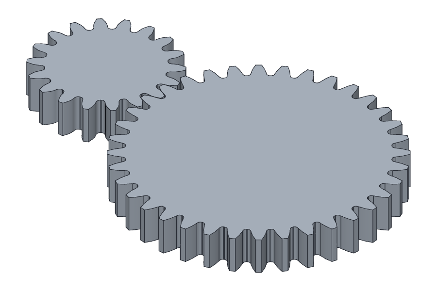
  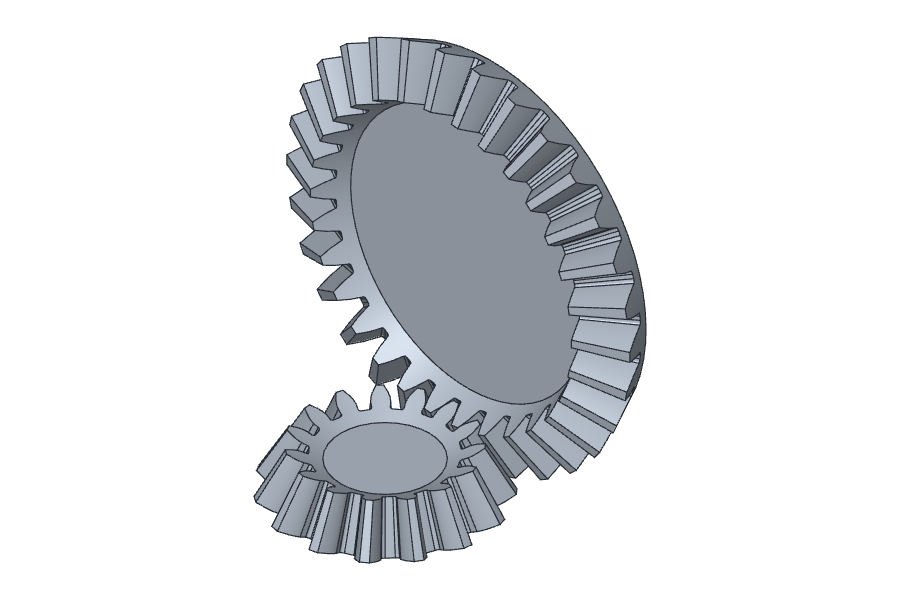
  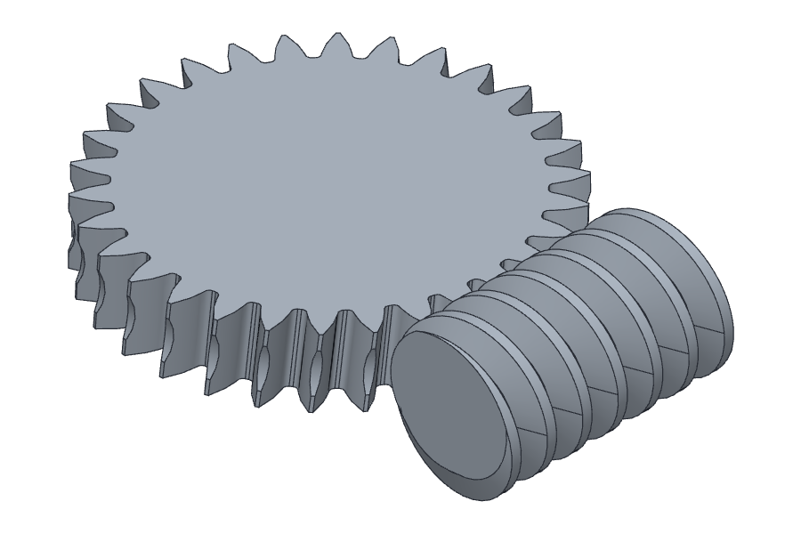
  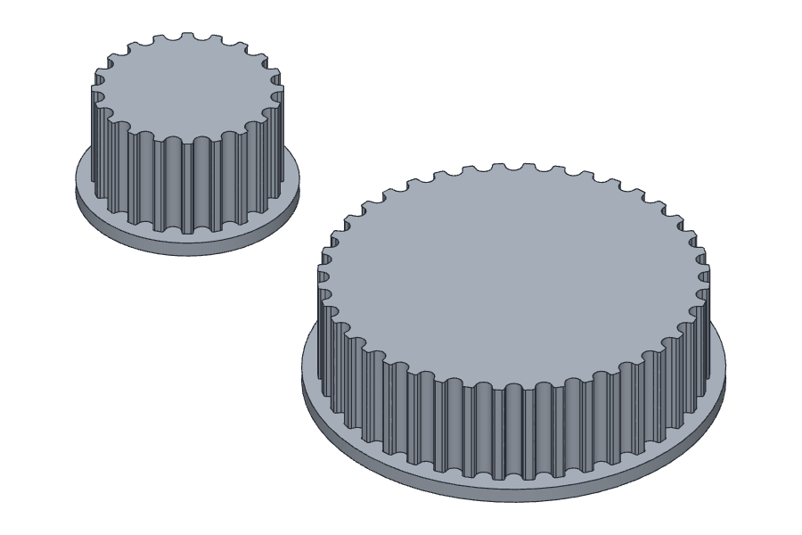

## Install

Requires SolidCraft 0.50.0 or later.

1. Download `gear-kit-<version>.zip` from [Releases](https://github.com/rob089/solidcraft-gear-kit/releases).
2. In SolidCraft: **Plugins › Install plugin…**, pick the zip.
3. Use it from **Plugins › Gear Kit**. SolidCraft asks you to approve it on first use.

## Usage

- Every entry creates a pair of gears. Turn off *Create* on one side for a single part.
- Part 1 sits on the Z axis, part 2 is placed where it meshes.
- The *Result* row shows the key numbers, or what's wrong (`⚠ z2: cone 80.5° > 72°`). Hover a field's name for details.
- Only the toothed part is made. Add bores and hubs yourself.
- SolidCraft stops a plugin after 30 s. Builds that would take longer are refused.

Calculated values are displayed in the first row (*Result*):

| | |
|---|---|
| `a` | centre distance |
| `i` | ratio: teeth of part 2 ÷ teeth of part 1 |
| `εα` | contact ratio: teeth in mesh on average, should be above 1.1 |
| `δ` | pitch cone angles of bevel gears 1 and 2 |
| `γ` | lead angle of the worm; below 5° it is likely self-locking |
| `d`, `do` | pitch and outside diameter of a single pulley |
| `mm/turn` | rack travel per turn of gear 1 |
| `z1`, `z2`, `x1`, `x2` | teeth and profile shift of part 1 or 2, in a warning |

## Spur, helical and herringbone gears

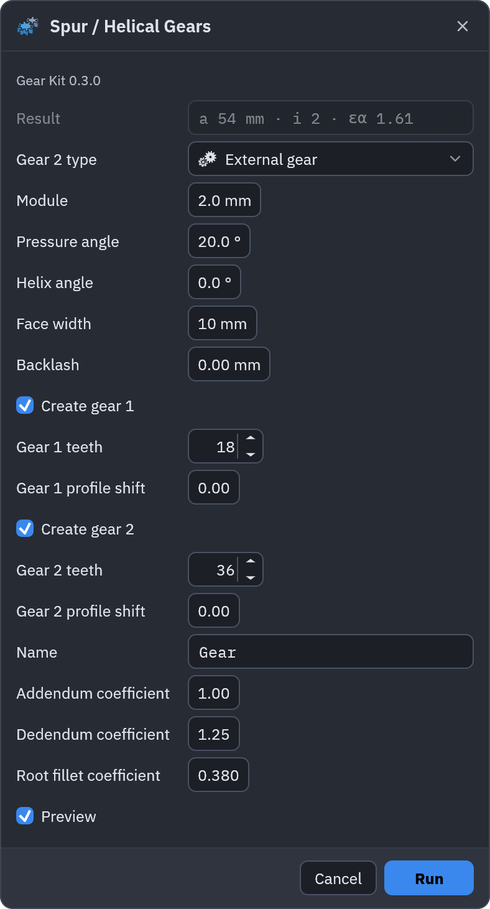

- **Gear 2 type**: external gear, ring gear or rack.
- **Module**: tooth size. **Pressure angle**: 20° is standard.
- **Helix angle**: 0 for spur gears. Above 0, *Hand* and *Herringbone* appear.
- **Face width**, **Backlash**: backlash is split between both gears.
- **Create gear 1/2**, **teeth**, **profile shift**: per gear. A profile shift changes the centre distance.
- **Name**: prefix of the body names.
- **Addendum, dedendum, root fillet coefficient**: the basic rack, standard 1 / 1.25 / 0.38.

Limitations:
- Spur gears up to 200 teeth; helical up to ~150, herringbone ~90, helical ring gears 80.
- No strength calculation.

 

|  | 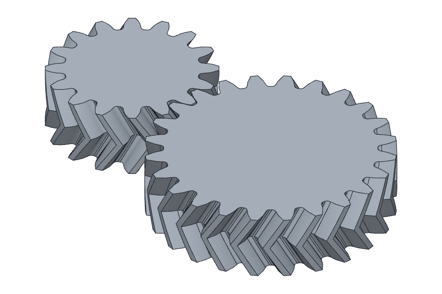 |
|---|---|
| Module 2, 18/36 teeth → `a 54 mm · i 2` | Helix 30°, herringbone, 16/24 teeth |
| 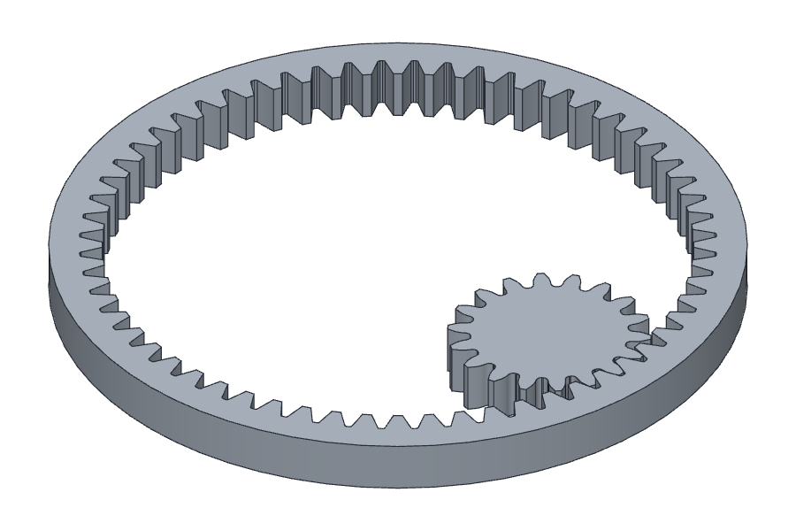 | 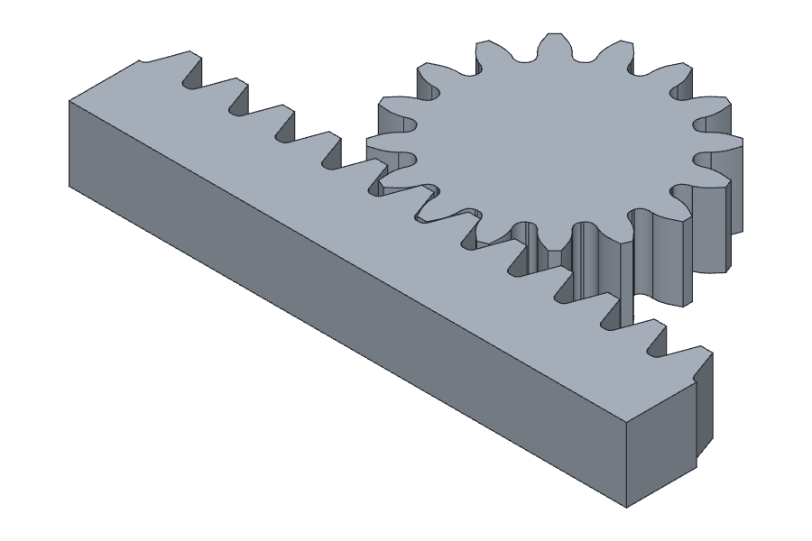 |
| Ring gear, 18/60 teeth → `a 42 mm · i 3.333` | Rack, 16 teeth → `⚠ undercut 1` |

## Bevel gears

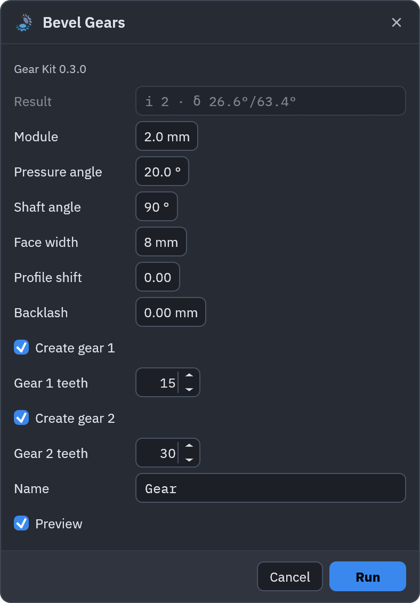

- **Module**: tooth size at the outer end. Bevel teeth taper toward the cone tip. **Pressure angle**: 20° is standard.
- **Shaft angle**: angle between the two axes, 20° to 120°.
- **Face width**: tooth length along the cone.
- **Profile shift**: +x for gear 1, −x for gear 2.
- **Backlash**, **Create gear 1/2**, **teeth**, **Name**: as for spur gears.

Limitations:
- Straight teeth only.
- Pitch cone angle ≤ 72°: at 90° shaft angle a ratio up to about 1:3.

 

|  | 15/30 teeth, 90° shaft angle → `i 2 · δ 26.6°/63.4°` |
|---|---|

## Worm gears

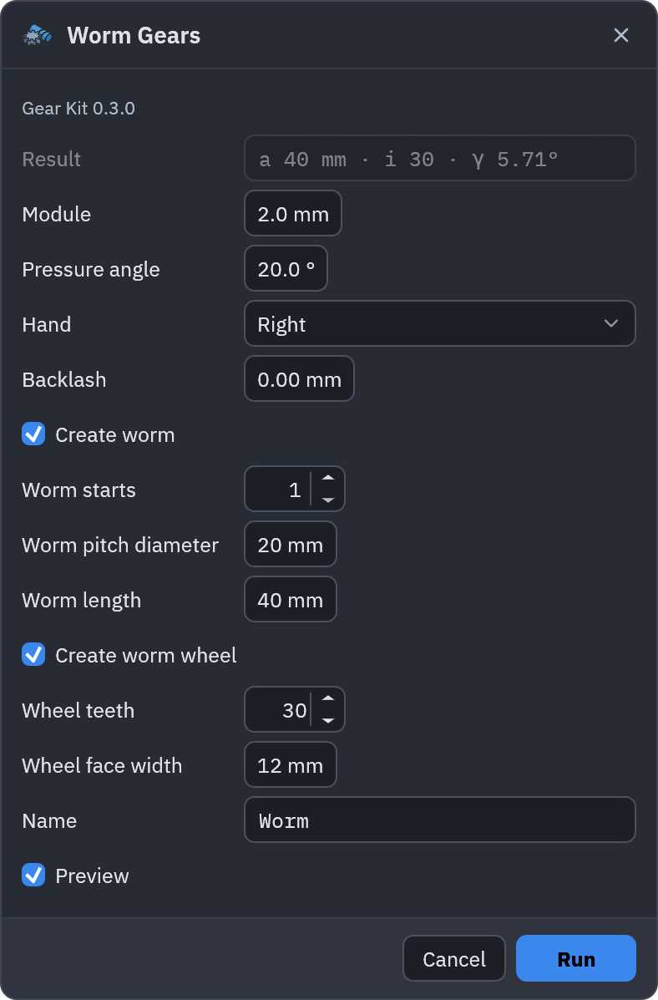

- **Module**, **Pressure angle**: axial, of the worm.
- **Hand**: the wheel gets the same hand.
- **Worm starts**: ratio = wheel teeth ÷ starts.
- **Worm pitch diameter**, **Worm length**: usually 8 to 16 modules for the diameter.
- **Wheel teeth**, **Wheel face width**: the worm wheel.
- **Create worm / worm wheel**, **Backlash**, **Name**: as for spur gears.

Limitations:
- The wheel approximates a hobbed wheel: fine for printing and light loads.
- Wheel 10 to 80 teeth.

 

|  | Module 2, 1 start, wheel 30 teeth → `a 40 mm · i 30` |
|---|---|

## Timing pulleys

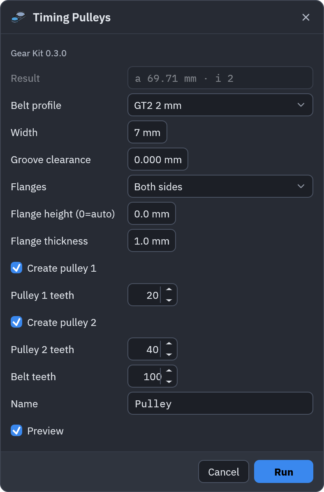

- **Belt profile**: GT2 2/3 mm, HTD 3M/5M/8M (ISO 13050), T2.5/T5/T10 (DIN 7721-2), MXL/XL (ISO 5294).
- **Width**: of the toothed part.
- **Groove clearance**: widens the grooves for printing; try 0.1–0.2 mm.
- **Flanges**: none, one (below) or both. **Flange height** 0 = the standard's minimum.
- **Create pulley 1/2**, **teeth**: per pulley.
- **Belt teeth**: belt length in teeth. Sets the centre distance.
- **Name**: prefix of the body names.

Limitations:
- GT2 is not standardised: check the fit with a test print.
- No belt is modelled.
- Up to 250 grooves (HTD 200).

 

|  | 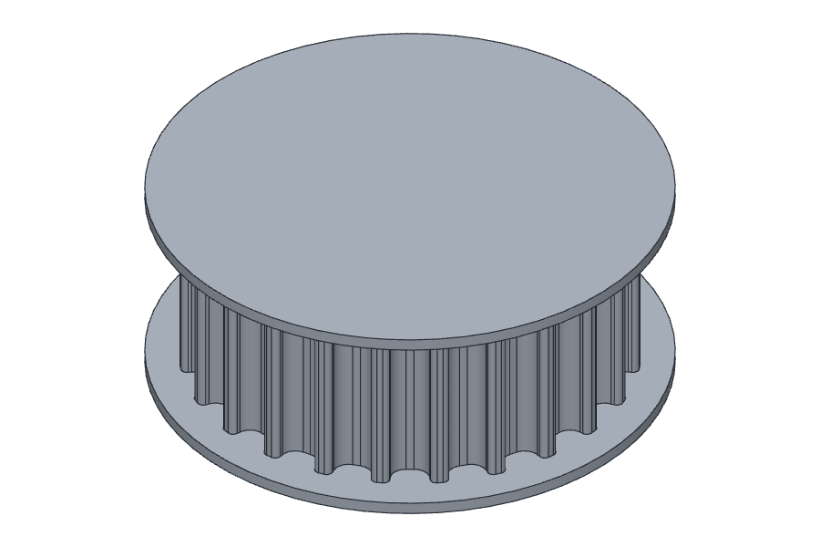 |
|---|---|
| GT2 20/40, 60-tooth belt → `a 29.31 mm · i 2` | HTD 5M, 24 teeth, flanges |

## Editing

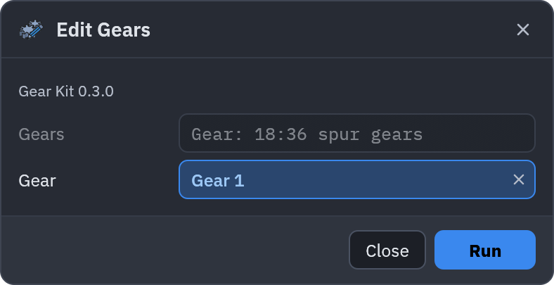

**Plugins › Gear Kit › Edit Gears**, pick a gear or pulley, Run: its dialog opens with its values. Apply replaces it in place; features cut into it by body name follow.

Limitations:
- Refused while a sketch or fillet sits on one of its faces or edges. Move or delete those first.

 

## License

MIT, see [LICENSE](LICENSE).
